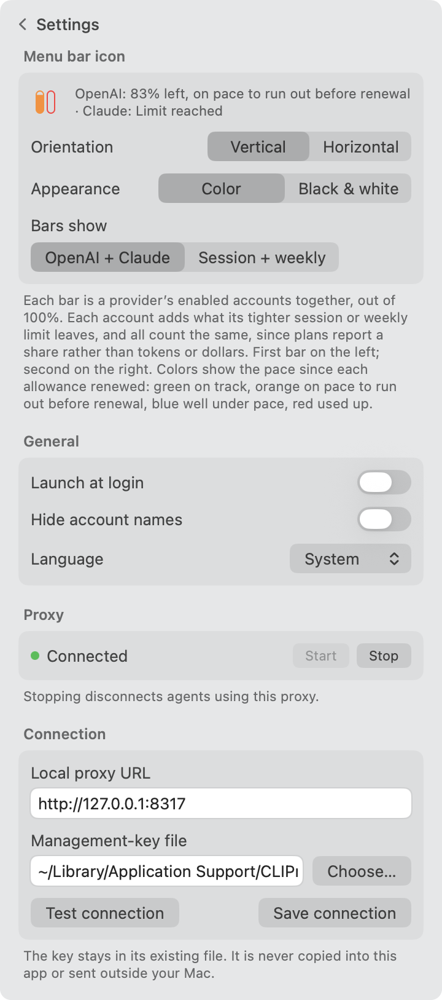

# Juice Bar


**Your CPAMC subscriptions in the macOS menu bar.**

A native CPAMC add-on with a compact menu design: system typography, two stacked allowance bars colored by your pace, a per-account list, and individual quota details.

The add-on has two parts: a **native macOS companion** and a small **CLIProxyAPI C-ABI plugin** that registers a “Juice Bar” resource in CPAMC. It is a third-party extension, not an official CPAMC/CLIProxyAPI product. CPAMC and the native app read the same local CLIProxyAPI account pool.

## Install

Paste this into Claude Code, Codex or another coding agent on your Mac:

```text
Install this: https://raw.githubusercontent.com/mindtheflo/juice-bar/stable/INSTALL.md
```

The agent follows [INSTALL.md](INSTALL.md): it downloads the latest release, builds Juice Bar from source, installs it in `~/Applications`, starts it at login and checks the connection to CPAMC. It never reads your management key. From then on, Juice Bar [updates itself](#updates). To do it yourself, see [Build and install](#build-and-install).

## Screenshots

Captured directly from the native app on macOS, cropped to the menu panel. These screenshots use fictional demo subscriptions, never personal account names or credentials.


| Account details | All settings in one place |
| --- | --- |
|  |  |

## What it shows

- Claude and Codex accounts connected to your local CPAMC/CLIProxyAPI instance, including disabled accounts. Disabled accounts show readable usage but never count as available; rows without a usage reading cannot be opened. Hover a provider’s header to hide or show its disabled accounts; the choice is remembered per provider.
- Subscription plan, remaining allowance, five-hour/weekly windows, reset times, and local proxy cooldowns.
- **Pace** for each session and weekly allowance: at the rate you have used it since it renewed, will it run out first? Green is on track, orange runs out before it renews, blue is well under (less than half used by then), red is used up. An allowance's details say when it runs out at this pace, or about how much of it you will have used by its renewal.
- Paid credits and extra-usage availability separately from included subscription quotas.
- Unused Claude promotional reset counts, without consuming them.
- Native light/dark appearance, English/French, a privacy switch, launch-at-login, automatic updates and connection testing, grouped on one Settings page.
- Menu-like behavior: closing the menu discards the open page, selection and unsaved edits, so it always reopens on the overview.
- Separate Claude session and weekly bars, left to right.
- A **Use this account** toggle inside each subscription’s detail view. It changes that exact account in CPAMC, verifies the result, and leaves every other account untouched.
- Explicit Start/Stop controls for a matching local CLIProxyAPI login service.

Percentages are **not added across subscription accounts**. By default, the menu-bar icon shows the best available account's tightest shared allowance for each provider, in OpenAI/Claude order. Details expose model-specific windows separately. An old reading or an elapsed reset is not presented as newly available quota.

Pace is the average rate since an allowance renewed, carried on to its renewal. Until about a quarter of the window has passed, the estimate leans on a moderate pace, so one early burst or a quiet start does not decide it. An account or icon bar is orange if any of its shared allowances is on pace to run out, and blue only if all of them are well under. Without a renewal time, the color follows the level instead: orange at 10% left or less.

## Menu-bar icon preferences

Open **Settings** for a live preview and automatically saved preferences:

- **Vertical or horizontal** — two side-by-side gauges or two stacked gauges.
- **Color or black & white** — pace colors or native macOS template tint, matching neighboring menu-bar icons and adapting to light/dark backgrounds. In black & white, the icon's tooltip still tells the pace.
- **OpenAI + Claude** — each provider's best available account, using its tighter session/weekly limit.
- **Session + weekly** — sum OpenAI + Claude, out of 200% per window (100% per provider). One best available account per provider contributes both windows. This equal-weight quota indicator is not a combined token/credit balance. If one provider has no reading, the combined bar shows the known contribution as a lower bound (≥), still out of 200%, and names the unreported provider in the tooltip. Missing values never erase known allowance. Both missing means unknown, not zero.

The first metric is on the left (vertical) or top (horizontal). Disabled, stale and unavailable accounts do not contribute usable quota. Unreported limits and confirmed zero quota keep an empty outline; the tooltip distinguishes “No reading” from exhausted quota. The default is vertical, color, OpenAI + Claude. The app logo is the vertical **Twin Meter** design, paired with the Juice Bar wordmark.

## Requirements

- macOS 13 or later and Xcode Command Line Tools with Swift 6 or later.
- CPAMC backed by a running local CLIProxyAPI. Tested with CLIProxyAPI 8.0.4 and CPAMC 1.26.2.
- Its management key available in a local text file. CPAMC's dashboard password is the management key, not a client API key.

## Build and install

```sh
git clone https://github.com/mindtheflo/juice-bar.git
cd juice-bar
swift test
bash scripts/install.sh
```

The installer builds the app from source into `.build/app`, replaces any earlier Juice Bar in `~/Applications/Juice Bar.app`, keeps your settings and opens it. Add `--login` to start Juice Bar at login, or turn on **Launch at login** in Settings. A build of `nightly`, the default branch, updates itself once the branch it follows includes its commit: `stable`, unless you choose **Nightly** in **Settings › Updates**. A build with uncommitted changes never does.

An app you build yourself is never quarantined, so it opens without Apple notarization. Local builds are ad-hoc signed; to sign with your own Developer ID certificate, pass its identity:

```sh
CODESIGN_IDENTITY="Developer ID Application: Your Name (TEAMID)" bash scripts/install.sh
```

`bash scripts/build.sh` writes the distribution copies to `dist/`: `Juice Bar.app`, `Juice Bar.app.zip` and the CPAMC plugin. The repository includes them, signed but not notarized: a copy downloaded with a browser is quarantined and blocked by Gatekeeper, so prefer building from source.

There is no standalone app window or Dock icon: the subscription panel is a compact, arrow-free dropdown anchored to the menu-bar icon. It closes on an outside click or Escape. Its two allowance bars appear in the macOS menu bar. Click them to inspect subscriptions, or choose **Open CPAMC** to open the existing quota dashboard.

## Updates

Juice Bar updates itself from source, so it needs no notarization or update server. Once a day it asks GitHub for the latest commit of the branch it follows: `stable` for releases, or `nightly` for every change as soon as it is merged. When there is a new one, it fetches it into `~/Library/Application Support/Juice Bar`, builds it with that commit's `scripts/build.sh` and the running app's signing identity, and checks the result: commit, app identifier, signature and team. The new version replaces the app while its menu is closed, right away or as soon as you close it, and reopens in the background. Settings and the login item are kept.

- Choose the branch in **Settings › Updates**, which also shows the state, the version and the commit it was built from. A new branch is checked right away.
- Only a clean build is replaced, and only by a later commit of its branch: a withdrawn release is never replaced by an older or different commit, and after switching from Nightly back to Stable the app keeps its version until Stable includes it.
- Turn off **Update automatically** to update only with **Check now** and **Install**.
- Updating needs the Xcode Command Line Tools. The source and build cache use about 90 MB; `update.log` in the same folder records the last updates.

## Connect your CPAMC instance

The default connection is `http://127.0.0.1:8317`, with the key read from:

```
~/Library/Application Support/CLIProxyAPI/management-key
```

Choose **Settings…** in the menu to change the URL or select an existing key file. Only loopback connections are accepted. The key remains in that file; this app does not copy credentials, log response bodies, or package secrets.

**Upgrading from an earlier build or CPAMC Menu Bar:** since 0.3.0, the app identifier is `io.github.mindtheflo.juice-bar`. The installer quits the earlier app, copies its preferences to the new identifier and replaces it; an old `CPAMC Menu Bar.app` is moved to Trash. The configuration file, plugin ID and URL scheme are unchanged. Launch at login is reset by the new identifier: turn it back on in Settings or install with `--login`. Menu-bar managers such as Bartender may need the icon placed again.

Configuration is stored in `~/Library/Application Support/CPAMC Menu Bar/config.json`. A key-file path is stored, not the key itself. `config.example.json` shows the supported fields.

## Quotas are read-only

The app reads `/v0/management/auth-files` every 30 seconds. Every five minutes (or on explicit Refresh, with a 30-second minimum between reads), it asks the proxy to perform **GET-only** Claude usage/profile and Codex usage queries via `/v0/management/api-call`. Provider OAuth tokens are substituted by the proxy using `$TOKEN$`; they are never read from credential files by this app.

It makes **no model requests**, never buys/enables extra usage, never consumes promotional resets, never clears cooldowns, and never edits tokens. The explicit account toggle updates only that account’s enabled/disabled state through the management API; it does not change routing strategy or other accounts. The explicit Start/Stop buttons only control the matching local proxy process; stopping it interrupts agents using that proxy. The proxy continues running independently when this app quits. Service controls are available only when the existing `~/Library/LaunchAgents/com.flo.cliproxyapi.plist` points to the same CLIProxyAPI installation and port; unrelated services cannot be controlled. HTTP redirects are rejected to prevent the local management key from being forwarded elsewhere.

No analytics, cloud account, sign-in, or third-party packages are required. Connection diagnostics never include keys or raw provider errors.

## Diagnostics

```sh
swift run cpamc-quota-check
```

This prints a live, redacted quota snapshot, with each allowance's pace and projected use by its renewal, and exits. Use `--show-names` only when you intentionally want account names in your terminal. Disabled accounts are queried read-only too; a failed reading leaves the account disabled and never makes it available for routing. `cpamc-menubar --demo` uses fictional labels and no network calls, for screenshots/UI review.

## CPAMC plugin integration

The build also produces `plugin/cpamc-menubar.dylib` for the current Mac architecture, next to the app (`.build/app/plugin/` after `install.sh`, `dist/plugin/` after `build.sh`). Copy it into your CLIProxyAPI plugin directory, then enable only `cpamc-menubar` in your existing plugin configuration:

```yaml
plugins:
  enabled: true
  dir: /absolute/path/to/your/plugins
  configs:
    cpamc-menubar:
      enabled: true
```

Preserve any existing plugin settings. The plugin uses CLIProxyAPI's stable C ABI (version 1), and registers only a management resource: no model, routing, credential, quota or interception hooks. CPAMC lists its “Juice Bar” page in the plugin menu. Its resource is available at `/v0/resource/plugins/cpamc-menubar/menubar` and links to the installed native app, this repository and the existing quota dashboard. The resource page never reads keys or account data.

The native companion works even when you do not install the dashboard plugin. Disabling/removing this plugin does not stop the companion or the proxy.

## Remove it

```sh
bash scripts/uninstall.sh
```

Only this companion, its optional login item and its update cache are removed. CPAMC, CLIProxyAPI, all credentials and routing remain untouched. Local settings are retained.

If you installed the dashboard integration, disable/remove `cpamc-menubar` from CPAMC's Plugins page separately.

## Development

```sh
swift test
swift run cpamc-menubar --demo
```

The dependency-free `QuotaCore` target handles normalization, freshness, subscription aggregation, local proxy I/O and source updates. The SwiftUI target provides the native menu. Tests cover shared vs model-specific limits, pace, cooldowns, stale/unknown readings, disabled accounts, quota resets, provider payload formats, loopback-only connections, exact-account toggling, lost-response reconciliation, and updates built from a local repository.

### Releasing

`nightly` is the development branch, where pull requests are merged; `stable` is the release branch installed apps follow by default. To release, fast-forward `stable` to a tested commit of `nightly`:

```sh
git push origin nightly:stable
```

No tag is needed: an installed app updates when its branch moves past the commit it was built from. The version in `scripts/build.sh` and `plugin/plugin.c` is only shown in Settings. Protect both branches on GitHub (no force-push or deletion, restricted pushers to `stable`): installed apps build whatever they point to.

This repository contains no third-party provider logos. See [CLIProxyAPI](https://github.com/router-for-me/CLIProxyAPI) and [CPAMC](https://github.com/router-for-me/Cli-Proxy-API-Management-Center) for the upstream projects.

## License

[MIT](LICENSE) © 2026 Florian Pariset. Source, original branding assets and repository screenshots are included under this license.

Juice Bar is an independent project; it is not affiliated with PromptJuice or other similarly named products. Provider names belong to their respective owners.
